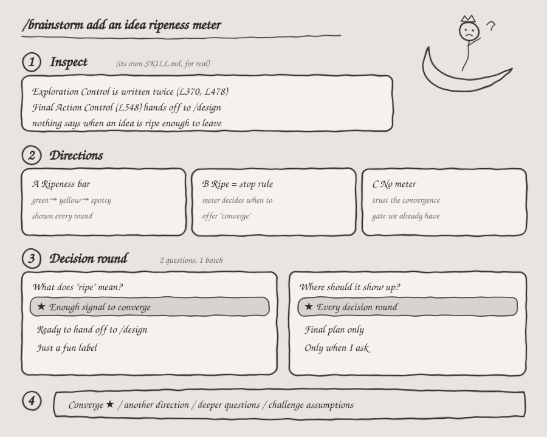

# /brainstorm

[](https://github.com/mizyoel/brainstorm)
[](#installation)
[](#)
[](LICENSE)

<p align="center">
  
</p>

> **Start with a rough idea. Leave with a clear direction.**

`/brainstorm` helps a coding agent sit with a rough feature, UX problem, data question, or architecture choice until the direction is clear.

## Installation

### GitHub CLI (no `npx` required)

With GitHub CLI 2.90.0 or later, install the skill for your user so it is available across projects:

```bash
gh skill install mizyoel/brainstorm SKILL.md --agent claude-code --scope user
gh skill install mizyoel/brainstorm SKILL.md --agent github-copilot --scope user
```

Omit `--scope user` to install into the current repository instead.

### Manual install with Git

Clone the repository into the skill directory for your agent. The repository itself is the skill folder, so keep its `SKILL.md` and `references/` together.

| Agent | Project install | Personal install |
| --- | --- | --- |
| Claude Code | `.claude/skills/brainstorm` | `~/.claude/skills/brainstorm` |
| GitHub Copilot | `.agents/skills/brainstorm` or `.github/skills/brainstorm` | `~/.agents/skills/brainstorm` or `~/.copilot/skills/brainstorm` |

For a personal Claude Code install on Linux:

```bash
mkdir -p "$HOME/.claude/skills"
git clone https://github.com/mizyoel/brainstorm.git "$HOME/.claude/skills/brainstorm"
```

For a personal GitHub Copilot install on Linux:

```bash
mkdir -p "$HOME/.agents/skills"
git clone https://github.com/mizyoel/brainstorm.git "$HOME/.agents/skills/brainstorm"
```

Use the same commands in Windows PowerShell, replacing `mkdir -p` with:

```powershell
New-Item -ItemType Directory -Force "$HOME/.claude/skills" | Out-Null
```

or, for Copilot:

```powershell
New-Item -ItemType Directory -Force "$HOME/.agents/skills" | Out-Null
```

Then run the matching `git clone` command above in PowerShell. For a project install, replace the destination with the corresponding project path from the table; run the command from your project directory.

### Download without a command line

On the repository page, choose **Code → Download ZIP**, extract it, then move the extracted skill folder into one of the skill directories in the table. Make sure `SKILL.md` is directly inside `brainstorm`, alongside `references/`.

### Install with `npx`

```bash
npx skills add mizyoel/brainstorm
```

Then bring it a half-formed idea:

```text
/brainstorm redesign the dataset import experience
```

## Why use it?

Coding agents are great at building. The dangerous shortcut is jumping directly from:

```text
idea → code
```

`/brainstorm` adds the missing middle:

```text
idea → questions → directions → trade-offs → decision → plan → code
```

It helps prevent polished implementations of poorly defined ideas.

## How it works

1. **Understands the real problem** — users, constraints, current behavior, and what must remain unchanged.
2. **Asks focused questions** — only when an answer can materially change the design. There is no artificial three-question limit.
3. **Explores distinct directions** — not cosmetic variations of the same idea.
4. **Compares trade-offs** — usability, complexity, scalability, risk, and maintainability.
5. **Recommends a direction** — with clear reasoning and an actionable plan.

Here's a doodle of `/brainstorm` pointed at its own repo. The inspect findings come from this `SKILL.md`; the options and answers are sketched to show the flow.

<p align="center">
  
</p>

## What it can brainstorm

- **Product & UX** — flows, navigation, hierarchy, interaction patterns, states, and responsive behavior.
- **Architecture** — boundaries, ownership, APIs, state, jobs, persistence, failures, and scalability.
- **Data** — schemas, ingestion, lineage, normalization, ontology, validation, versioning, and retrieval.
- **Features** — user value, behavior, edge cases, feasibility, AI boundaries, and rollout.
- **Refactoring** — responsibilities, coupling, abstractions, migration, and technical debt.

Recommendations favor clear ownership, explicit state, simple data flow, testability, production failure handling, incremental migration, and SOLID principles.

## Example directions

For:

```text
/brainstorm improve the experiment selector
```

The skill might compare:

| Direction | Best for | Trade-off |
| --- | --- | --- |
| Workspace switcher | Visible global context | Uses persistent shell space |
| Command palette | Fast expert workflows | Less discoverable |
| Contextual selector | Simple local workflows | Weaker global orientation |

It then recommends the strongest fit for the actual workflow and turns it into a concrete plan.

## Keep exploring

The conversation stays open after the recommendation:

- **Start Implement** — turn the chosen direction into working changes.
- **Create Full Document** — expand it into a PRD, architecture document, or specification.
- **Enhance My Idea** — push the selected concept further.
- **Explore More** — generate more directions or resolve remaining uncertainty.
- **Stop Here** — keep the current result as the decision checkpoint.

## Try it

```text
/brainstorm architecture for collaborative annotation
/brainstorm normalize user-created dataset tags
/brainstorm simplify this React state architecture
/brainstorm modal, drawer, page, or inline workflow?
```

You can invoke `/brainstorm` directly, or an agent can use it proactively when a request contains meaningful product, UX, data, or architectural uncertainty.

---

<!-- /design promotional banner: add design-skill-banner.webp beside this README -->
<p align="center">
  <a href="https://github.com/mizyoel/design">
    
  </a>
</p>

<p align="center">
  <strong>Know what to build?</strong> Continue with <a href="https://github.com/mizyoel/design"><code>/design</code></a> to shape it into a professional interface.
</p>

---

```bash
npx skills add mizyoel/brainstorm
```

**Let `/brainstorm` sharpen the idea before the compiler gets involved.** 🧠
